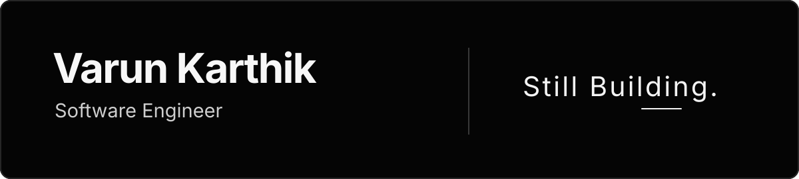

  

  <a href="#projects">Projects</a>&nbsp;&nbsp;·&nbsp;&nbsp;
  <a href="https://www.linkedin.com/in/varunkarthik99/">LinkedIn</a>&nbsp;&nbsp;·&nbsp;&nbsp;
  <a href="mailto:varunraj.karthikeyan@gmail.com">Email</a>

### About me

Hi, I'm Varun. I'm a software engineer based in Cleveland, Ohio. Most of my work is with **React, TypeScript, and Node.js**, but I enjoy working across a product, from how it feels to use to how it behaves when something goes wrong.

I've worked on production insurance and travel platforms at **GoDB Technologies** and **Dafidy Technologies**, building customer-facing workflows, shared components, and API integrations. I completed my master's in Computer Science at **Cleveland State University**. More recently, I've evaluated AI-generated engineering work at **Mercor** and volunteered with **Develop for Good**.

I like building software that makes a real problem less frustrating for someone. Sometimes that means a better interface. Sometimes it means making a complicated workflow reliable enough that people can trust it.

### A few results from my professional work

<table>
  <tr>
    <td align="center" width="33%"><strong>300K+</strong> Users served by insurance workflows</td>
    <td align="center" width="33%"><strong>~800 ms to &lt;150 ms</strong> Interaction to Next Paint after React rendering improvements</td>
    <td align="center" width="33%"><strong>3 to 1.5 weeks</strong> Feature delivery cycle with shared components</td>
  </tr>
</table>

## Projects

<table>
  <tr>
    <td width="45%" valign="top">
      
    </td>
    <td width="55%" valign="top">
      <h3>UI Merge Studio</h3>
      
This started with a problem I ran into while building FlowCraft. AI coding tools produced different React implementations, and I often wanted parts of each. UI Merge Studio lets you pick supported features from running previews, trace them back to Git and Babel AST source evidence, and verify a combined branch. It refuses combinations it cannot safely handle instead of guessing.

      
<code>React</code> <code>TypeScript</code> <code>Vite</code> <code>Git</code> <code>Playwright</code>

      <a href="https://ui-merge-studio.vercel.app/">Interactive showcase</a> · <a href="https://github.com/varun-raj-77/ui-merge-studio">Source and technical details</a>
    </td>
  </tr>
  <tr>
    <td width="45%" valign="top">
      
    </td>
    <td width="55%" valign="top">
      <h3>FlowCraft</h3>
      
A visual workflow builder where you can design automation graphs, generate editable workflows with AI, and follow execution in real time. I built the canvas with React Flow and used Socket.IO for node-level updates. The hard part was treating generated output as untrusted: graphs go through validation before they can be saved, while immutable revisions and prompt lineage make changes easier to inspect and recover.

      
<code>Next.js</code> <code>TypeScript</code> <code>React Flow</code> <code>Node.js</code> <code>Socket.IO</code>

      <a href="https://flowcraft-ai-workflow-builder.vercel.app/">Try FlowCraft</a> · <a href="https://github.com/varun-raj-77/flowcraft-ai-workflow-builder">Source and architecture</a>
    </td>
  </tr>
  <tr>
    <td width="45%" valign="top">
      
    </td>
    <td width="55%" valign="top">
      <h3>Samewise</h3>
      
Two datasets can describe the same person or organization in different ways, and a simple join can make the wrong call. Samewise proposes record matches, explains agreements and contradictions, and leaves uncertain identities to a human reviewer. After matching, people can decide which values to keep and export reconciled data with an audit trail. It uses a React interface, a Fastify API, and a Python matcher.

      
<code>React</code> <code>TypeScript</code> <code>Fastify</code> <code>Python</code> <code>Vitest</code>

      <a href="https://trysamewise.vercel.app/">Try Samewise</a> · <a href="https://github.com/varun-raj-77/samewise">Source and evaluation</a>
    </td>
  </tr>
</table>

### Tech I work with

**UI:** React, TypeScript, Next.js, React Native, React Flow, Zustand

**Services and data:** Node.js, Express, Fastify, REST, GraphQL, SQL, MongoDB, Python

**Testing and tooling:** Playwright, Vitest, Jest, React Testing Library, Git, Docker

---

  <a href="https://www.linkedin.com/in/varunkarthik99/">LinkedIn</a>&nbsp;&nbsp;·&nbsp;&nbsp;
  <a href="mailto:varunraj.karthikeyan@gmail.com">Email</a>&nbsp;&nbsp;·&nbsp;&nbsp;
  <a href="https://github.com/varun-raj-77?tab=repositories">All repositories</a>

