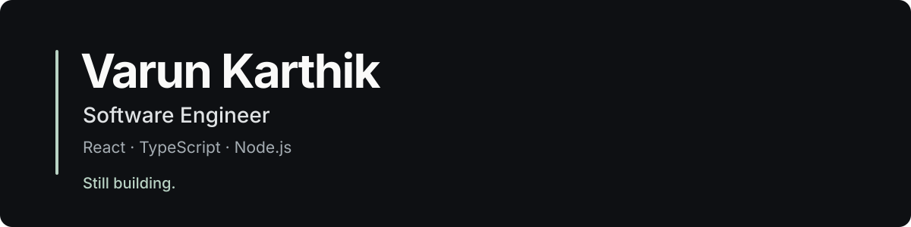

  

  <strong>Software Engineer</strong> 
  React · TypeScript · Node.js

  <a href="#projects">Projects</a>&nbsp;&nbsp;·&nbsp;&nbsp;
  <a href="https://www.linkedin.com/in/varunkarthik99/">LinkedIn</a>&nbsp;&nbsp;·&nbsp;&nbsp;
  <a href="mailto:varunraj.karthikeyan@gmail.com">Email</a>

### About

Hi, I'm Varun, a software engineer based in Cleveland, Ohio. I work mainly with React, TypeScript, and Node.js. I like building products that are straightforward to use and still work well when things go wrong.

I've worked on insurance and travel products at **GoDB Technologies** and **Dafidy Technologies**, and completed my master's in Computer Science at **Cleveland State University**. I also evaluate AI-generated code at **Mercor** and volunteer with **Develop for Good**.

Some of the projects below started with problems I ran into while building something else.

### Selected results from my professional work

<table>
  <tr>
    <td align="center" width="33%"><strong>300K+</strong> Users served by insurance workflows</td>
    <td align="center" width="33%"><strong>~800 ms to &lt;150 ms</strong> Interaction latency after React rendering improvements</td>
    <td align="center" width="33%"><strong>3 to 1.5 weeks</strong> Feature delivery cycle using shared components</td>
  </tr>
</table>

## Projects

<table>
  <tr>
    <td width="45%" valign="top">
      
    </td>
    <td width="55%" valign="top">
      <h3>UI Merge Studio</h3>
      
I started this after comparing multiple React implementations and wishing I could keep the parts I liked from each. It lets you select supported UI regions, trace them back to code and dependencies, and create a combined branch when verification passes.

      
<code>React</code> <code>TypeScript</code> <code>Vite</code> <code>Git</code> <code>Playwright</code>

      <a href="https://ui-merge-studio.vercel.app/">Try the showcase</a> · <a href="https://github.com/varun-raj-77/ui-merge-studio">Source code</a>
    </td>
  </tr>
  <tr>
    <td width="45%" valign="top">
      
    </td>
    <td width="55%" valign="top">
      <h3>FlowCraft</h3>
      
A visual workflow builder with AI-assisted graph generation, a React Flow editor, live execution updates, and revision history. The challenging part was making generated workflows safe to edit, save, and run.

      
<code>Next.js</code> <code>TypeScript</code> <code>React Flow</code> <code>Node.js</code> <code>Socket.IO</code>

      <a href="https://flowcraft-ai-workflow-builder.vercel.app/">Try FlowCraft</a> · <a href="https://github.com/varun-raj-77/flowcraft-ai-workflow-builder">Source code</a>
    </td>
  </tr>
  <tr>
    <td width="45%" valign="top">
      
    </td>
    <td width="55%" valign="top">
      <h3>Samewise</h3>
      
A tool for reconciling records across messy CSV datasets. It finds possible matches, shows the evidence behind uncertain cases, lets people decide which values to keep, and exports an auditable result.

      
<code>React</code> <code>TypeScript</code> <code>Fastify</code> <code>Python</code> <code>Vitest</code>

      <a href="https://trysamewise.vercel.app/">Try Samewise</a> · <a href="https://github.com/varun-raj-77/samewise">Source code</a>
    </td>
  </tr>
</table>

### Tech I work with

**UI:** React, TypeScript, Next.js, React Native, React Flow, Zustand

**Services and data:** Node.js, Express, Fastify, REST, GraphQL, SQL, MongoDB, Python

**Testing and tools:** Playwright, Vitest, Jest, React Testing Library, Git, Docker

---

  <a href="https://www.linkedin.com/in/varunkarthik99/">LinkedIn</a>&nbsp;&nbsp;·&nbsp;&nbsp;
  <a href="mailto:varunraj.karthikeyan@gmail.com">Email</a>&nbsp;&nbsp;·&nbsp;&nbsp;
  <a href="https://github.com/varun-raj-77?tab=repositories">All repositories</a> 
  Cleveland, Ohio · Open to relocation

